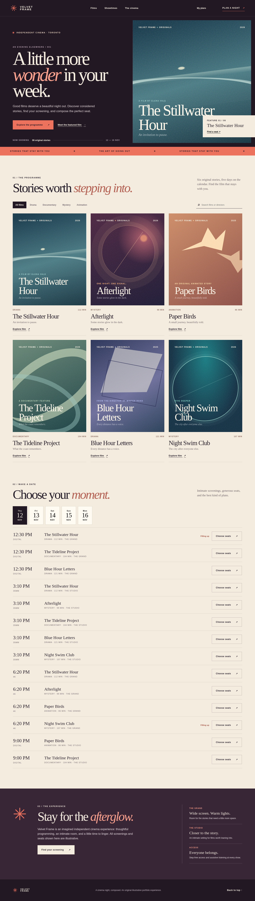
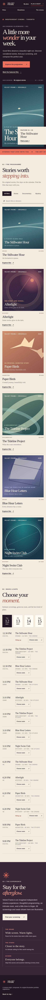

# Velvet Frame

**[Live Demo](https://miladmo68.github.io/velvet-frame-cinema/)** · **[Source repository](https://github.com/miladmo68/velvet-frame-cinema)**

   

An original, customer-facing independent cinema experience. Explore an editorial six-film programme, filter by genre, search films and directors, choose a date and screening, select seats on a visual auditorium map, set a ticket mix, and create a browser-local plan preview.

> **Illustrative experience:** Velvet Frame, its films, showtimes, seat inventory and prices are fictional demo content. A preview does not hold a seat, issue a ticket, send email or take payment.

## On a phone



## Features

- Six original fictional films, each with a custom CSS poster, synopsis and accessible detail dialog.
- Five-day schedule, genre filters, title/director search, and informative empty states.
- Deterministic seat inventory with occupied, accessible and companion seats, a six-seat group limit, and keyboard-operable selection.
- Adult, student and senior ticket mix with matching seat counts and transparent CAD preview total.
- Validated name and email, local plan previews, persistence across reloads, and a removable plan drawer.
- Responsive mobile and desktop layouts, focus containment/restoration, skip link and reduced-motion support.
- Static Next.js export on free GitHub Pages; no paid database, API, secrets or payment provider.

## Technology and architecture

Next.js 16 App Router, React 19, TypeScript, custom CSS, Node domain tests, Playwright Chromium, GitHub Actions and GitHub Pages. The catalogue and seating model live in typed deterministic modules. Browser localStorage holds only illustrative plan details; the form email is validated but never persisted or sent. There is no backend transaction or real-world booking.

All poster artwork and interface code are original. See [attribution and research notes](ATTRIBUTIONS.md) and [product rotation notes](PRODUCT_NOTES.md).

## Development

```bash
npm ci
npm run dev
```

To run the release checks:

```bash
npm run lint
npm run typecheck
npm test
npm run build
npm run qa:browser
```

`qa:browser` runs against the production export in a cloud GitHub Actions runner and writes authentic desktop and phone screenshots to `public/screenshots/`. The release workflow generates the lockfile, executes all checks and captures screenshots before creating the public repository. The [release report](PROJECT_REPORT.md) lists the feature inventory and quality gate.

## Deployment

The public repository's GitHub Actions workflow installs locked dependencies, runs `npm run validate`, exports the static site and deploys `out/` to GitHub Pages. The live address is **[miladmo68.github.io/velvet-frame-cinema](https://miladmo68.github.io/velvet-frame-cinema/)**.
